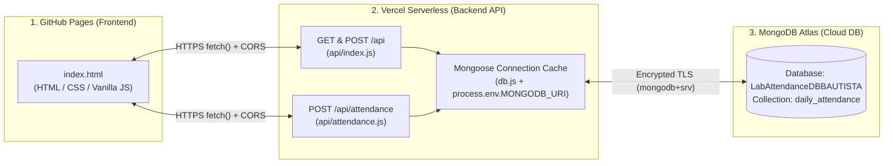

# Laboratory Attendance Management Console (`student-frontend`)

> **Office of the University Registrar • Academic Records Division**  
> A production web frontend for managing university laboratory session attendance, built with vanilla HTML, CSS, and JavaScript on **GitHub Pages** and powered by a **Vercel Serverless Node.js/Mongoose API** connected to **MongoDB Atlas**.

---

## 🔗 Live Deployment & Repository Links

| Resource | Link | Description |
| :--- | :--- | :--- |
| **🌐 Live Frontend (GitHub Pages)** | **[https://cyrus9177.github.io/student-frontend/](https://cyrus9177.github.io/student-frontend/)** | Public web application interface hosted on GitHub Pages |
| **⚡ Live Backend API (Vercel)** | **[https://student-api-backend-fawn.vercel.app/api](https://student-api-backend-fawn.vercel.app/api)** | Serverless REST endpoint returning live JSON from MongoDB Atlas |
| **⚡ Live Attendance Endpoint** | `https://student-api-backend-fawn.vercel.app/api/attendance` | `POST` endpoint for appending laboratory attendance dates |
| **📦 Frontend Repository** | **[https://github.com/Cyrus9177/student-frontend](https://github.com/Cyrus9177/student-frontend)** | Source code for this GitHub Pages frontend (`index.html`) |
| **🛠️ Backend Repository** | **[https://github.com/Cyrus9177/student-api-backend](https://github.com/Cyrus9177/student-api-backend)** | Source code for the Node.js + Mongoose Vercel Serverless API |

---

## 🏗️ System Architecture

Because **GitHub Pages** hosts static frontend files (`HTML`, `CSS`, and browser `JavaScript`), it cannot directly open a `mongodb+srv://` driver connection or store private database credentials securely. To solve this, the system uses a 3-tier decoupled cloud architecture:



1. **Frontend (`student-frontend` on GitHub Pages):** Renders the **Academic Registrar Meets Minimal Data Console** interface and communicates exclusively with the public Vercel API via `fetch()`. Contains zero database credentials.
2. **Backend (`student-api-backend` on Vercel):** Executes Node.js serverless functions using Mongoose, caches the database connection across invocations via `global.mongoose`, validates incoming payloads, enforces CORS headers, and stores `MONGODB_URI` securely in Vercel Environment Variables.
3. **Database (`MongoDB Atlas`):** Stores the `LabAttendanceDBBAUTISTA` database and `daily_attendance` collection across three laboratory sections:
   - **Network Administration** — `BSIT-3A 9332-AY226`
   - **Object-Oriented Programming** — `BSCS-2B 9487-AY226`
   - **Microprocessor Systems** — `BSCpE-4C 9105-AY226`

---

## 🗄️ MongoDB Document Structure (`daily_attendance`)

Each student document in `LabAttendanceDBBAUTISTA.daily_attendance` follows this schema:

```json
{
  "_id": "6ad1e624df86e9984c242ce2",
  "studentName": "Dexter Morgan",
  "subjectName": "Network Administration",
  "section": "BSIT-3A 9332-AY226",
  "attendanceDates": [
    {
      "date": "2026-10-08",
      "status": "Present"
    },
    {
      "date": "2026-10-15",
      "status": "Present"
    },
    {
      "date": "2026-10-22",
      "status": "Present"
    }
  ]
}
```

- **Supported Attendance Statuses:** `Present`, `Late`, `Absent`
- **Date Format:** `YYYY-MM-DD`

---

## 🔌 Backend API Endpoints (Hosted on Vercel)

Base URL: `https://student-api-backend-fawn.vercel.app`

### 1. `GET /api` — Fetch All Student Attendance Records
Retrieves all documents from `daily_attendance`, sorted consistently by `subjectName`, `section`, and `studentName`.

```bash
curl https://student-api-backend-fawn.vercel.app/api
```

### 2. `POST /api` — Register a New Student Document
Creates a new student record in `daily_attendance` with `attendanceDates` defaulting to `[]`.

**Request Body:**
```json
{
  "studentName": "Dexter Morgan",
  "subjectName": "Network Administration",
  "section": "BSIT-3A 9332-AY226"
}
```

### 3. `POST /api/attendance` — Record a Laboratory Session Date
Appends a `{ date, status }` object to an existing student's `attendanceDates` array by MongoDB `_id`. Automatically prevents duplicate dates (`HTTP 409 Conflict`) for the same student even if the submitted status differs.

**Request Body:**
```json
{
  "studentId": "6ad1e624df86e9984c242ce2",
  "date": "2026-10-29",
  "status": "Present"
}
```

---

## ✨ Frontend Features & Design System

### Design Direction: *Academic Registrar Meets Minimal Data Console*
- **Color Palette:**
  - Main Background: `#F6F6F2`
  - Primary Dark Navy: `#203649`
  - Muted Green Accent: `#547163`
  - Surface White: `#FFFFFF`
  - Main Text: `#263238` | Secondary Text: `#67736D` | Restrained Border: `#E1E4DC`
- **Typography:** `Source Serif 4` for institutional headings, `IBM Plex Sans` for UI controls and tabular legibility, and `IBM Plex Mono` for section codes, dates, and database telemetry.

### Key Functional Capabilities
- **Live Ticking Atlas Telemetry Clock:** Displays real-time connection status (`Atlas Live · HH:MM:SS`) in the registrar top bar alongside the last synchronization timestamp in the ledger footer.
- **Animated In-App Ledger Refresh:** The **Refresh Ledger** button spins while re-fetching fresh records from MongoDB Atlas without reloading the browser page.
- **Staged Change Verification Modal ("Before → After" Preview):** Allows users to inspect newly staged student registrations or attendance date additions (highlighted with a pulsing `+ NEW` badge) before committing them permanently to MongoDB Atlas.
- **Duplicate Attendance Prevention:** Displays already-recorded dates when a student is selected and blocks duplicate date submissions on both the frontend and backend.
- **Interactive Section Tabs, Search & Pagination:** Filter immediately by section (`All Sections`, `BSCS-2B`, `BSCpE-4C`, `BSIT-3A`), search by student name/subject/date, and navigate pages using `← Prev`, numbered page buttons, `Next →`, and configurable rows per page (`5`, `6`, `10`, `All`).
- **Safe DOM Rendering:** Uses `document.createElement()` and `textContent` exclusively when rendering database fields to prevent XSS injection.

---

## 🚀 Local Development

Since the frontend is built with zero-dependency vanilla HTML, CSS, and JavaScript, you can run it locally with any static file server:

```bash
git clone https://github.com/Cyrus9177/student-frontend.git
cd student-frontend
python -m http.server 5500
```

Then open `http://localhost:5500` in your browser.
